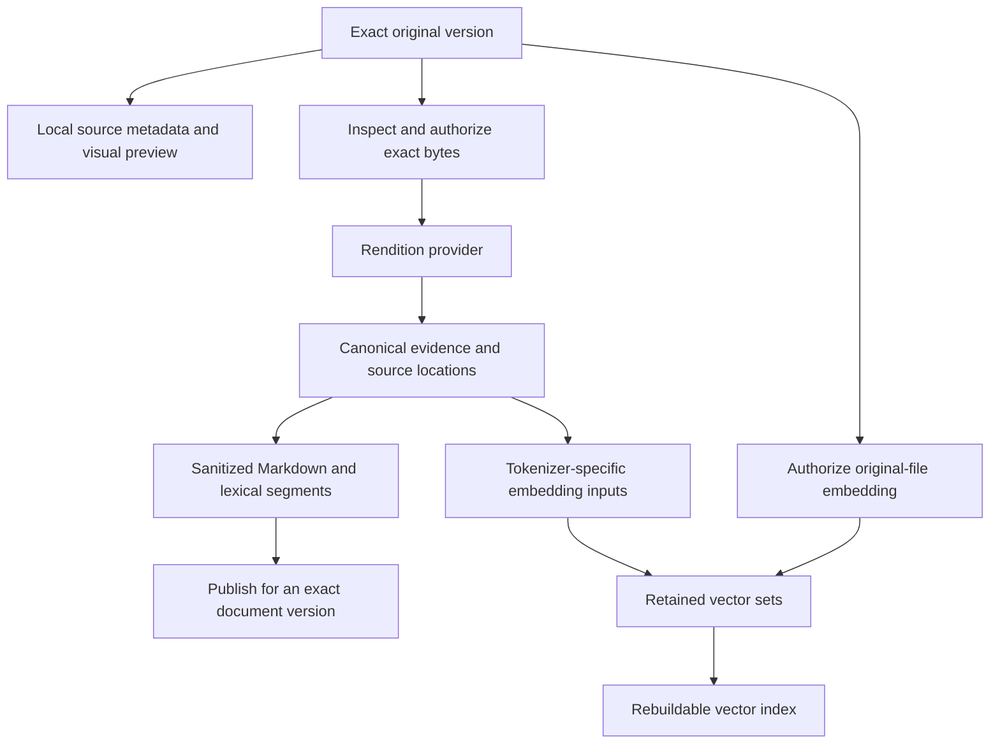

# Document processing

Docbank stores original document versions separately from any results derived
from them. A new extractor or embedding model can produce a new result without
rewriting the original, and search uses only results that the vault has
published for the relevant document version.

This page covers the implemented Go contracts and internal processing
architecture. If you are building an application that chooses extractors or
embedding providers, start with
[Document understanding in Go](../document-understanding.md).

## Which interfaces expose this work?

| Interface | Current scope |
|-----------|---------------|
| Public `document/*` Go packages | Evidence, rendition, OCR, upload, embedding, and provider contracts; the importing application owns orchestration and persistence |
| Public embedded vault API | Plan and run processing, read retained renditions and coverage, and search exact source versions in lexical, semantic, or hybrid mode. Also process local metadata and read visual previews. See [Embed in Go](../embedding.md) |
| Daemon background jobs | Local metadata, checksum, and visual-preview work; configured rendition and embedding jobs; vector-index rebuilding |
| Internal processing and storage packages | Profiles, consent, publication, retention, and derivative purge |
| Internal retrieval packages | Lexical, semantic, and hybrid retrieval; optional expansion and reranking; QMD export and query adapters |
| CLI and HTTP | Preview and run profiles, inspect jobs, read retained renditions, and search current live versions automatically in the CLI or through an explicit source-version fence |
| Web app and TUI | Preview processing, record consent, inspect jobs, and read retained sanitized renditions |

The default configuration includes no processing profiles. The daemon can
execute its built-in plaintext, EPUB, and PDF text rendition adapters;
configured Docling, Mistral OCR, and compatible-vision rendition runtimes; and
the OpenAI-compatible, Voyage, and standard embedding bridge
(`docbank-standard-embedding-bridge/v2`) embedding runtimes listed in
[Configuration][embedding-runtime]. Embedded Go callers can also use other
public provider packages, though adding a package does not register a daemon
runtime. Configuration alone does not grant consent or enqueue work.

[embedding-runtime]: ../configuration.md#embedding-workers-and-credentials

`configureRenditionProviders` selects `document/epub` for `docbank-epub-rendition/v1`
and passes the existing byte and unit limits to its constructor. That provider
owns the `epub.in-process-v1` descriptor and virtual-unit policy, and startup
rejects any descriptor or trust-boundary drift. The same checks apply to
`document/pdftext` and `docbank-pdftext-rendition/v1`, with byte and page limits
bound into the descriptor. Its sealed `PDFTextOnly` inspection policy admits
opaque image streams and external references while keeping parser bounds, and
the PDF text provider releases PDFium's shared lease after each page.
Omission-only partial PDFs retain normalized evidence and a canonical
frontmatter envelope with an empty body; verified-empty reads require that
exact envelope's size and checksum. Unknown adapters remain unavailable.

For the operator workflow covering profile selection, preview, consent,
execution, and reads, see
[Document processing](../usage/document-processing.md). For lexical, semantic,
hybrid, and auto modes with an explicit profile and authorized source-version
fence, see [Automatic and processing search](../usage/search.md). When you
configure a query embedding binding, plain CLI search automatically selects
hybrid retrieval over current live file versions and reports a degradation
reason if it falls back to ordinary lexical search. Explicit processing search
keeps the caller's profile and authorized source-version fence.

## From original bytes to searchable evidence

Canonical evidence records what the extractor found and where it came from,
including ordered units, source locators, regions, headings, artifacts, and
explicit omissions. If extraction is partial or degraded, the result retains
that status instead of claiming complete document coverage. Timed transcript
units retain optional speaker identity and half-open millisecond spans, while
untimed supplied transcripts follow the same contract without invented
timestamps or speaker identities.

A rendition holds sanitized Markdown and model-independent text segments for
keyword search. Embedding input generation reads canonical evidence rather than
the retained Markdown wrapper, applying a named tokenizer, chunk policy, and
document-role formatter. This keeps navigation metadata and frontmatter out of
embedding text. Direct-file embeddings skip the rendition and use separately
authorized original bytes instead.

Local [source metadata](source-metadata.md) and
[visual previews](visual-previews.md) use their own processors and version
identities and do not require a hosted rendition provider.

## Keep policy and result identities separate

A processing profile is an immutable description of extraction, text handling,
embedding inputs, retention, disclosure, and retrieval limits, and its
fingerprint is a checksum of that declared policy. Credentials appear as named
bindings; the profile never retains secret values.

Docbank also computes separate fingerprints for the rendition request, evidence
and lexical policy, each embedding-input policy, each vector space, and
retention and disclosure. That separation lets Docbank reuse work at any layer
whose inputs still match. Changing embedding chunking does not redefine the
original or make a different extractor result equivalent.

The built-in plain-text policy has no vault-specific inputs. Docbank computes
its canonical JSON and fingerprints once per process so text imports and
restore queue rebuilds can reuse them, while giving each caller its own JSON
bytes. Extraction eligibility and purge suppressions still read the vault's
current transaction state.

A vector space defines which vectors you can compare: provider descriptor,
model, dimensions, metric, normalization, scalar encoding, and input formatters
all matter. Docbank checks destination-sensitive disclosure identities
separately, and matching dimensions alone do not establish compatibility.

OpenAI-compatible runtimes select a vector-space identity separately from the
runtime pin. New v2 spaces include every vector-producing descriptor field and
the complete deployment contract, including weights and tokenizer revisions,
while endpoint, credentials, timeouts, limits, and egress policy stay part of
the runtime pin and consent. When you run an unchanged upgrade, Docbank keeps
an existing v1 space if its full descriptor matches, so the first query retains
coverage without rewriting saved vectors. An exact existing v1 space takes
precedence over a matching v2 space.

After a policy change, grant consent and explicitly build the documents for the
current profile. Jobs reuse compatible retained values after checking ordered
input IDs, rendered checksums, and payload authority, and call the consented
provider for unavailable values. Because v1 records cannot prove their
deployment revisions after a policy change, legacy BGE-M3 and Qwen3 sets
require the full descriptor pin to match, and their first move can require
re-embedding. Search and similarity read one selected space through the usual
index leases and source checks.

The [profile contract](https://github.com/kenn-io/docbank/blob/main/document/profile.go)
owns these identities, and the
[embedding contract](https://github.com/kenn-io/docbank/blob/main/document/embedding.go)
owns provider requests and compatibility checks.

## Keep text search ready across restarts

When you open a vault, Docbank moves retained plain-text results into rendition
authority if needed. The first migration publishes search state and queues
missing or failed legacy extractions for repair in a single transaction. Later
checks evaluate the same current document versions as that migration, while
historical versions keep their immutable builds without needing current search
heads.

After that first migration, a terminal failure from the current plain-text
extractor remains completed work; restarting or publishing another document's
text does not queue it again. Missing results still need extraction, queued
retries keep their schedule, and derivative purge suppressions still apply.
When nothing needs publication or repair, opening the vault avoids reading and
rebuilding all cached text.

## Authorize disclosure before provider work

Inspection binds the operation to the exact source hash, byte count, detected
format, and locally measured limits. The upload layer stages those bytes and
issues a one-shot authorized reader. Provider adapters receive that reader
instead of arbitrary access to the vault, and the outbound transport checks the
declared origin and allowed network ranges when it establishes the actual
connection.

PDF format detection requires a versioned `%PDF-` header at byte zero and a
`startxref` within the final 64 KiB whose offset points backward to a
recognized cross-reference table or stream. Each cross-reference read is capped
at 4 KiB. A cross-reference table uses its own trailer when that trailer fits
in the read, and the final trailer otherwise; either way, a complete trailer
must immediately precede the last `startxref`. This rule accepts linearized
(Fast Web View) tables whose final trailer may omit `/Root`, as well as
hybrid-reference updates whose empty table links to another section through
`/Prev` or `/XRefStm`. Linearized streams may need a second read to validate
the forward link to the final cross-reference section.

A final `%%EOF` marker may be followed by whitespace, NULs, or short text or
binary residue within the tail window, while appended ZIP signatures, `<` or
`>` bytes, repeated end markers, and PDF revision syntax are rejected. The last
`startxref` stays authoritative, so an incomplete appended revision cannot fall
back to an older valid revision, and missing-final-marker recovery still allows
only PDF whitespace after the offset. These checks recognize the format;
subsequent inspection validates the page tree, encryption, external references,
and policy limits before authorizing provider work.

The final cross-reference stream must close with `endstream` and `endobj`
before the last `startxref`, though complete objects without streams, such as
an indirect `/Length`, may sit between them. When the stream starts inside the
tail window, detection locates `endstream` by keyword; a stream that starts
earlier needs a direct `/Length` that ends inside the window. Because detection
cannot find the end of an earlier-starting stream with an indirect `/Length`
within its bounded reads, it rejects those streams.

Before you grant consent, you review each flow's runtime disclosure: immediate
and ultimate processor, endpoint, deployment, model and revision, vector space,
provider-visible metadata, and retained artifact roles. The plan fingerprint
seals those values alongside the exact source and portable profile. Embedded
callers supply endpoint disclosures for network providers when opening the
vault; see [Embed in Go](../embedding.md#configure-document-processing) for the
configuration contract.

A durable consent grant records the principal, scope, processing-profile and
disclosure fingerprints, permitted input classes, retained artifact classes,
and optional expiry. Workers check the grant before provider egress, hold a
fence against revocation while the call runs, and verify authority again at
publication. A replacement grant does not revive work whose original grant was
revoked.

Restoring a vault starts a new processing incarnation, which is a new local
identity for provider authority. Restored history still explains previous
consent, but old grants never authorize new outbound requests.

The [consent catalog](https://github.com/kenn-io/docbank/blob/main/internal/store/consent.go),
[upload package](https://github.com/kenn-io/docbank/tree/main/document/upload),
and [provider transport](https://github.com/kenn-io/docbank/tree/main/document/providerhttp)
implement these rules. Provider capability manifests and a vault's
human-consent records have different jobs, and neither substitutes for the
other.

## Publish complete results for exact versions

The rendition catalog separates an immutable build from the attachment that
lets one content version use it. Multiple attachments inside the vault can
reuse the same build, and an active head selects which attachment is visible
for a given content-version and processing-profile pair.

Workers store attempts, leases, and provider-operation state separately from
completed builds. A resumable provider can keep polling a recorded operation
without reopening source bytes. If a submission outcome is ambiguous, the
worker resumes a known operation or requires operator action instead of
automatically uploading the source again. A late or stale worker cannot publish
over newer authority, and rendition attachment changes publish together with
lexical serving generation changes.

Embedding inputs, vector sets, and version-specific embedding sets are also
immutable records. Because each embedding binding has its own active head, an
optional failed binding does not replace another binding's successful result.
Vector values live in validated blob artifacts while SQLite tracks their
identity and membership. The vector-index worker builds disposable generations
from those retained sets and publishes only against the source membership it
read, while reader leases keep a selected generation available during a query.

Coverage reads source visibility, serving heads, and replacement jobs in a
single catalog snapshot. A replacement counts as `rebuilding`, and the separate
`previous_generation_serving` count records whether a complete prior result
remains available; those documents are not also counted as `complete`.
Embedding coverage runs the same current attachment and evidence checks as
search, and any missing required result keeps aggregate coverage `partial` even
while other work is rebuilding. See the
[HTTP coverage contract](http-api.md#coverage-and-source-fenced-search).

Within that snapshot, rendition coverage fully validates each distinct build
and attachment-profile pair once. Documents sharing a build keep their own
visibility and rebuilding counts without reloading the same extracted text.
Docbank discards validation results when the request ends; later reads evaluate
the current catalog again.

The [rendition worker](https://github.com/kenn-io/docbank/blob/main/internal/processing/rendition_worker.go),
[rendition catalog](https://github.com/kenn-io/docbank/blob/main/internal/store/processing_catalog.go),
[embedding catalog](https://github.com/kenn-io/docbank/blob/main/internal/store/embedding_catalog.go),
and [vector-index catalog](https://github.com/kenn-io/docbank/blob/main/internal/store/vector_index.go)
own these implementations.

## Explain retrieval without granting authority to a provider

The internal searcher treats omitted and `auto` modes as lexical, while
explicit semantic and hybrid modes require compatible active vector authority
and a query encoder. A source-version fence selects eligible vectors from
current, live attachments before scoring. Unscoped searches score the whole
leased generation and recheck each inspected neighbor against current vault
authority, and missing vector-row authority stops the search. Results retain
source references, lexical and semantic rank contributions, coverage,
truncation, and degradation details. Before passing candidates to optional
reranking, Docbank checks them against current vault authority.

SQLite tracks a derived membership revision for each vector space as embedding
heads, rendition heads, content versions, previews, and photo eligibility
change. Search checkpoints reuse an in-process checksum memo while the
snapshot's revision matches; the first checkpoint after a membership change or
restart captures the source again without writing bookkeeping.

For a timed rendition segment, lexical evidence resolves the exact lexical
segment to its build unit, and rendition-chunk semantic evidence resolves the
exact input generation and source unit from retained canonical artifacts. Both
paths return the same optional `time_span` shape and exact build identity,
while direct-file embeddings and untimed evidence omit `time_span`. Zero is a
valid segment start and stays present in JSON. Hybrid results keep each lane's
separate evidence reference instead of combining disjoint spans, and the daemon
HTTP API preserves these spans for CLI and web clients.

The processing service caches verified timing mappings for up to 100,000
inputs, while a cold lookup still reads the retained generation and evidence
artifacts. If an artifact cannot be read or verified, search omits the affected
semantic hit and marks the report `truncated`, leaving other documents
available.

Query expansion produces bounded alternate queries, and reranking reorders an
already authorized candidate list using bounded excerpts and evidence
references. Each stage requires its own authorization, deadline, and explicit
choice to fail the query or return degraded results, and its receipt records
the outcome and counts without retaining query or excerpt text.

QMD is an operator-hosted document-search service. Docbank supplies an export
and query adapter for QMD alongside these internal reranking adapters:

| Internal adapter | Purpose |
|------------------|---------|
| [`internal/retrieval/cohere`](https://github.com/kenn-io/docbank/tree/main/internal/retrieval/cohere) | Hosted `rerank-v4.0-pro` or `rerank-v4.0-fast` |
| [`internal/retrieval/zeroentropy`](https://github.com/kenn-io/docbank/tree/main/internal/retrieval/zeroentropy) | Hosted `zerank-2` reranking |
| [`internal/retrieval/qmdbridge`](https://github.com/kenn-io/docbank/tree/main/internal/retrieval/qmdbridge) | Query an operator-hosted QMD endpoint and resolve results through Docbank authority |

A QMD export contains verified Markdown and a manifest mapping QMD URIs back to
exact Docbank versions and rendition artifacts, and publication selects a whole
immutable collection generation. The query adapter holds consent through the
request, checks the selected generation, and resolves returned candidates
against the current vault and requested scope. QMD's index never becomes the
source of document ownership or current-version truth.

Similar-document retrieval scores every stored source row against the fenced
candidate rows. Cosine and dot product keep the greatest score, while L2 keeps
the smallest distance and returns its negative. When several documents share a
vector-set row, the store preserves every document membership. It deduplicates
only the scoring inputs, then expands matches before excluding the source node
and grouping by content hash. For example, two eligible copies of a result
appear as one row with `duplicate_count: 1`.

Current/live eligibility, binding authority, and vector-index leases apply to
both source and candidates, and the final transaction rechecks source identity
and the source manifest. Missing source coverage returns an unavailable report.
Similar-document retrieval never invokes an encoder or provider. Ordinary
processing search keeps its existing document results; see the
[HTTP contract](http-api.md#similar-documents).

The [searcher](https://github.com/kenn-io/docbank/blob/main/internal/retrieval/search.go)
and [optional provider stages](https://github.com/kenn-io/docbank/blob/main/internal/retrieval/providers.go)
own the detailed retrieval contract. These packages are internal integration
building blocks, not public Go imports or CLI recipes.

## Reopen a saved quotation

A retained text citation binds a vault, file node, immutable source version and
hash, published rendition attachment and build, Markdown hash, and Unicode
range. The [HTTP operation](http-api.md#retained-text-citations) and default
[MCP tool](../usage/mcp.md#saved-text-citations) reopen that exact text even if
the profile is no longer configured or executable, and the read never calls a
provider or selects newer evidence.

The store checks the complete reference in one metadata snapshot. The file must
be live, untrashed, and still own the historical version, and the attachment
must remain published and unsuppressed with a matching build, profile, source
hash, and sanitized-Markdown artifact. A retained build without that attachment
is not enough, and purge suppression denies the read even when another
dependency keeps the attachment or bytes alive.

Replacing source content or the active rendition does not invalidate retained
attachments, and ordinary derivative GC keeps their builds. Trashing the file
makes the citation unavailable until restore, while pruning its version or
purging its rendition can remove it permanently. A backup restore preserves the
authority present in that snapshot. Saving a citation adds no retention root,
job, lease beyond the read, or promise that its evidence remains available.

The service holds `CaptureContext` from metadata lookup through full blob
verification and close, ending the database transaction before blob I/O. This
shared capture gate blocks physical maintenance, including purge, while
allowing backup's short metadata freeze. Logical mutations may finish after the
snapshot; an already admitted read can still complete, while later reads see
the changed authority. Embedded vaults keep their existing serialized gate
behavior.

Each resolution streams the complete rendition, up to 64 MiB, retains only the
requested quote, and verifies the full digest, size, and UTF-8 stream before
returning text. Even a short quote costs a full read. Cancellation and I/O
causes stay distinct from corrupt evidence. This verification covers the stored
sanitized Markdown; it does not prove provider correctness or quote verbatim
bytes from the original PDF, email, or Office file.

## Read the section around a quotation

The [outline and section reads](http-api.md#retained-text-sections) use the same
retained citation authority and accept historical attachments without a
configured processing profile. A saved reference is an anchor rather than a
retention lease; each page checks authority again, and a successful first page
does not promise that a later page stays available.

Navigation reads are stateless. The service admits two at a time across outline
and section requests, and waiting is cancelable without consuming a report,
export, or processing-job slot. Inside `CaptureContext`, the service resolves
metadata, copies the entire verified artifact, closes the stream, and releases
capture protection before parsing. Purge and repack can then proceed while the
request works from its owned bytes. Logical trash after admission does not
invalidate that read, though later requests see the changed authority.

Each navigation request accepts at most 4 MiB of Markdown, 65,536 LF
characters, and 4,096 document-root headings. Goldmark's block parsers and
paragraph transformers, including GFM tables, derive headings from the stored
Markdown. Inline parsing is omitted; section titles use their source lines, and
parsing emphasis, links, and code spans can take quadratic time without
contributing section information. Docbank does not render or normalize the text
again. A synthetic root covers all text, and each heading includes its
subsections. Section bounds count Unicode code points and preserve source
whitespace, escapes, and line endings, while labels stay bounded navigation
metadata rather than quotations. See the
[HTTP reference](http-api.md#retained-text-sections) for boundary, label, and
pagination rules.

The admission slot covers I/O, parsing, and response construction. Docbank
checks for cancellation around parsing and during scans, though Goldmark's
synchronous parser cannot be interrupted mid-call. These input and concurrency
caps limit input size and concurrent reads rather than a fixed heap or CPU
budget. Returned strings do not retain the whole source buffer or syntax tree,
and nothing is cached or stored after the operation finishes.

Every page rereads and reparses the whole artifact, even a final empty page;
choose the largest useful page size. Existing short citations still stream
artifacts up to 64 MiB independently of navigation slots. `rendition get` can
retrieve an attachment still active for its version, not a superseded
attachment, and navigation does not add historical bulk download.

Omission-only PDF builds settle chunk processing across restarts, while
original-file embedding bindings still need their own results. Older binaries
refuse omission-only evidence or its empty Markdown body, so downgrading
requires a version that can read these results.

## Retain, restore, or remove derived results

Your processing profile declares whether Docbank retains provider Markdown,
sanitized Markdown, and typed artifacts. Docbank catalogs retained evidence,
renditions, embedding-input generations, and vector sets against verified
blobs, keeping original content versions as separate authority.

Backups include the retained derivative catalog and the blobs it authorizes.
During restore, Docbank validates them and rebuilds lexical and vector indexes
from retained local data without rerunning extraction or calling embedding
providers. See [Backup architecture](backup.md) for the snapshot and restore
boundary.

The internal derivative-purge operation removes selected serving attachments
and collects complete builds or generations only when no remaining root needs
them; shared attachments, active workers and readers, and backup pins can all
retain a result. A durable suppression prevents background discovery from
silently recreating a purged result, and rebuilding requires an explicit
authorization that supersedes that suppression.

Derivative purge preserves original versions and does not erase copies in
existing backup repositories. When you remove a source version, Docbank first
revokes its derived serving authority and then leaves shared-result collection
to the same retention rules. The
[garbage collector](https://github.com/kenn-io/docbank/blob/main/internal/store/gc.go)
and [purge suppressions](https://github.com/kenn-io/docbank/blob/main/internal/store/derivative_suppression.go)
own these rules.

For the sanitized Markdown envelope, body-relative navigation, and consumer
source identity contract, see [Document derivatives](document-derivatives.md).

## How are large audio sources bounded?

`document/media.MaxMediaSourceBytes` sets both the default and maximum
streaming media source ceiling at 4 GiB, represented as `int64`, and you can
lower it through the daemon's `[media].max_source_bytes` setting or embedded
`ProcessingOptions.MediaMaxBytes`. HTTP envelopes add only 128 KiB for
multipart metadata and framing. Source staging, aggregate staging reservations,
publication, and rendition inspection all share that configured ceiling. Rather
than materializing a seekable copy, sequential rendition inspection and sealed
upload preparation read verified blob streams with terminal verification and a
catalog size check. Audio admission and worker runtime preparation intersect
the ceiling with the selected profile's source limit.

Because the configured ceiling is a separate size check rather than part of the
sealed inspection policy, changing it leaves queued execution identities
intact. Sources up to 1 GiB inspect under the 1 GiB document bound even when
the profile allows more, and only larger streaming sources select the 4 GiB
ceiling; raising the ceiling therefore leaves inspection records for already
admissible sources unchanged. If a lowered ceiling refuses a queued source,
that job fails with `stale_authority`, and a new plan re-admits it once the
ceiling allows it again. The built-in supplied-transcript and supplied-captions
profiles allow 4 GiB original sources while keeping their 16 MiB transcript,
caption, and response limits separate.

During processing, Docling and Mistral document runtimes read the configured
PDF password file only after inspection identifies an encrypted PDF. Inspection
decrypts and validates an in-memory copy and carries only the successful
password in the process-local upload proof, keeping passwords out of JSON,
policy fingerprints, and record checksums. The provider sends the decrypted
copy and records its upload digest separately from the original source digest.

A locked PDF without a working password enters the job queue and fails there
with `pdf_password_required`. A build with the same inspection checksum can
reopen the failed queued job. Because adding a working password changes the
capability checksum, the next build creates a new job and preserves the failed
job. Other adapters keep the `encrypted_container` admission refusal.

Audio keeps its 24-hour duration and codec qualification bounds. WAV and MP3
inspection hash every byte while retaining parser headers and a fixed copy
buffer. WAV chunk skipping uses `int64` counts even on 32-bit systems. Source
lengths never select a sample allocation size. Because document inspectors
materialize the source, they keep their existing 1 GiB ceiling, while visual
detection and remote MP4 originals stay bounded at 20 MiB. Only
identities that select the streaming WAV or MP3 inspector use the audio
ceiling; other audio, including M4A, keeps the 1 GiB document bound, so a
larger source receives a `source_bytes_exceeded` refusal before inspection.
Hosted-provider limits still apply before uploads to those providers.

Staging reserves the declared length before creating its private file. That
reservation is an aggregate service quota, not a claim about filesystem free
space. If disk space or a filesystem quota runs out while creating, writing, or
syncing the stage, or while writing the durable loose copy at publication,
Docbank returns `ErrMediaStagingUnavailable`, which HTTP exposes as retryable
503 `media_staging_unavailable`. Failed staging closes and removes its file and
releases the reservation. Operators can free space and retry the same
operation.

The HTTP processing plan route applies the 60-second handler deadline itself
instead of through `timeoutMiddleware`, while Huma's five-second body-read
deadline still bounds JSON decoding. Under that 60-second deadline, the handler
resolves the selector and asks `Service.PlanStreamsLargeSource` whether the
plan inspects a source above 1 GiB that the profile admits; only streaming audio
qualifies. For a qualifying plan, the handler clears the socket read deadline
and inspects under the request context, so client cancellation, caller
deadlines, and browser-session revocation still stop it. Every other plan,
including sources the profile refuses by size, keeps the 60-second deadline.

During publication, a source may need both its stage and durable loose copy on
disk at the same time, and provider execution may also hold a sealed spool
copy.

## Photo description suggestions

A vision profile runs through the shared rendition queue as a `derived_upload`
job on one content version. Its input binding hashes the version with the
verified grid-preview checksum, and automatic and explicit requests for one
version share a single job. Planning inspects the cached preview locally,
verifying, decoding, and re-encoding it without calling a provider. Enqueue and
the worker each repeat that inspection, so the provider receives a JPEG with no
metadata. Egress and publication recheck consent, display membership, hidden
state, and the preview checksum.

Planning checks preview readiness before estimating upload bytes and sealing
the plan fingerprint. Because each ready preview is immutable, a preview that
finishes during planning cannot leave an eligible plan with a stale byte
estimate.

Instead of writing a rendition artifact, publication writes one
`photo_suggestions` row per content version. Parsing drops only an invalid
caption or an oversized tag and clips visible text at 16 KB. Automatic backfill
treats a version with a row as settled unless it is a restored row still
awaiting regeneration, while an explicit run under a new producer fingerprint
refreshes rotation for an already described photo. Publication preserves
existing caption, tag, and dismissal decisions and keeps the text producer
fingerprint. A repeated explicit request under a different fingerprint can ask
for rotation again, including after an uncertain answer.

Accepting fields runs through the authored edit transaction and clears them
from the row in the same transaction. Suggested text lives in
`photo_suggestion_fts` and tag names in `tag_fts`, so search needs no
provenance state. Metadata JSONL keeps dismissals, per-field resolution, and
whether a row still awaits regeneration, without generated text or angles. An
unconfirmed rotation proposal also sets the awaiting marker even when caption
text was dismissed, and regeneration keeps that dismissal. A row with pending
text or rotation restores as awaiting and regenerates to fill only the open
fields, while a row with nothing pending restores settled. Derived-upload jobs
rebuild after restore; see [suggested metadata](../usage/photos.md#suggested-metadata).

### Photo best-shot reports and responses

The existing quality backfill measures faces from the verified, oriented grid
JPEG, sampling each crop at 16 by 16 pixels and leaving crops smaller than
eight pixels unmeasured. Reports retain the detector's nullable facing, eyes,
and smile observations, and `photo_quality_signals` caches reports with ordered
source face IDs, crop geometry, and detector observations. The source query
captures its canonical SQL signature with the faces, and publication rechecks
display ownership and that signature; naming and candidate decisions keep it
valid. Reads suppress stale reports while retaining whole-photo measurements,
and the evaluator fingerprint includes face-crop measurement choices and source
encoding.

Library page reads and bounded active-stack preparation compute KEEP/CUT offers
without writing, while cull grouping leaves offer evaluation to active-stack
preparation. Confirmed frames leave planning before ranking, and an
owner-confirmed pick settles the stack. Pending offers and face reports
regenerate locally.

The existing stack decision route checks membership and every source file,
recomputes offers, and compares their asset/flag pairs with those displayed.
Accept writes the offered flags, and Dismiss confirms each file's current flag;
both use the ordinary authored writer, revisions, receipt, Undo, backup, and
audited writes. Keep current preserves dismissed frames like other independent
owner choices, and existing 500-frame, 2,000-file, and Hidden-access limits
apply.

## Image interpretation renditions

`document/vision` also implements the opt-in
`docbank-compatible-image-understanding/v1` adapter and
`compatible-vision.understand-v1` descriptor. This task accepts original JPEG,
PNG, and WebP images up to 16 MiB through ordinary source inspection, consent,
egress fencing, and rendition jobs. It shares the compatible chat transport
with photo suggestions, while using its own prompt, descriptor, disclosure
fingerprint, and structured artifact contract. Existing photo-description and
face-detection identities remain unchanged.

The provider requires bounded string fields for visible text, literal
description, possible meaning, and uncertainty; missing, null, oversized, or
malformed fields fail the result. Docbank records empty fields as omissions and
fails an all-empty response without retry. Section labels are escaped, and
provider text stays in fenced Markdown blocks. Each supported section is a
separate evidence unit with its semantic layer and machine-generated caveat in
`heading_path`. The `rendition-chunk-headings/v1` formatter carries those
headings into each embedding input using generation version 2, and search
prefixes them to excerpts. The prompt requests transcription without
interpretation, grounds tentative meme meaning in visible evidence, and
prohibits identifying people or inferring beliefs, endorsement, or intent.
Treat that prompt as model guidance rather than a guarantee about model
accuracy. No conversation context is disclosed.

Because generated explanations have no verified source text coordinates,
evidence explicitly records degraded provenance. The source hash, prompt/model
policy, request identity, receipt, and artifact checksum follow the existing
rendition publication contract, and normalized evidence and sanitized Markdown
feed ordinary lexical segments and optional `rendition_chunk` embedding
bindings. Search and evidence windows keep the exact content-version and build
identities. Neither the suggestion catalog, authored photo metadata, a separate
vector store, nor any face identity mechanism participates.
