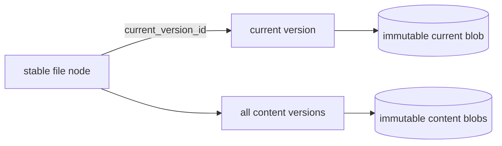

# Editing and versions

When you edit a file in Docbank, you add a new immutable version while keeping
its earlier versions intact. The file's **node ID** identifies the document
across moves and renames, while a **version ID** identifies one retained state
of that file, including its bytes and media type.

To replace content, use `docbank document put`. To edit in a local editor, use
`docbank document edit`. To make a prior version current again, use
`docbank document revert`. Users and agents can list versions, inspect one by
UUID, and retrieve its bytes after the file moves or is renamed. This page
defines the contracts for versions, replacement, reversion, and pruning.

## Version contract

During initial ingest or remote upload, Docbank creates an immutable
`content_create` record in the same SQLite transaction as the file node. Each
record carries:

- A random, canonical UUIDv4 `version_id` that is never allocator-derived
- The stable node ID and node revision that introduced it
- The SHA-256, byte length, and media type for the immutable blob
- A canonical UTC recording time
- A separate random operation UUID and transition kind

A node's `current_version_id` points to a version belonging to that same node.
SQLite enforces that cross-reference, along with one version per node revision
and one version per node and operation pair. If two files contain identical
bytes, they share one blob but still get distinct version and operation
identities.

Moves, renames, trash, and restore change node metadata and revisions without
creating content versions. An idempotent re-import that skips an existing file
creates no version either.

## Read surfaces

```bash
docbank document versions list /taxes/2025/return.pdf
docbank document versions show <version-uuid> --json
docbank document versions cat <version-uuid> > return.pdf
docbank document refs <sha256>
```

`versions list` returns versions newest-first and uses `--limit` and `--offset`
for pagination. Adding `--json` returns the complete page envelope, including
`total`. `versions show` and `versions cat` look up metadata or bytes by UUID,
independent of the node's current path. `refs` runs the inverse lookup, mapping
one content hash to every stable node and version pair that retains it,
including prior versions and trash.

The HTTP equivalents are:

- `GET /api/v1/nodes/{id}/versions?limit=&offset=`
- `GET /api/v1/versions/{version_id}`
- `GET /api/v1/versions/{version_id}/content`
- `GET /api/v1/content-references?sha256=&limit=&offset=`

Both current-node streams and ID-addressed version streams send
`X-Docbank-Content-Version`, `X-Docbank-Blob-Hash`, and `X-Docbank-Blob-Size`
before the body, then a computed `Content-Digest` trailer after a successful
EOF. Clients must still hash privately staged bytes and compare them against the
trailer before publishing them.

## Retention and backup

Every retained content-version row is a GC reachability root, whether or not it
is the current head. Version pruning or deleting a file's tree metadata by
emptying trash can release those references. An unreferenced blob can become a
GC candidate only after those references are released. Repack may change
physical placement, but it never changes version identity.

Deterministic metadata JSONL includes every version and every node's current
pointer, so backup capture, verification, and restore preserve stable version
IDs across loose or packed physical representations. During import, Docbank
transactionally rejects dangling current pointers, cross-node pointers, size
disagreements, invalid UUIDs, and malformed JSON records. A backup captured
after pruning preserves the retained graph and does not resurrect deleted
version rows, while earlier snapshots stay independent historical records that
can still restore the state they captured.

## Replacing content

```bash
docbank document put revised.pdf /taxes/2025/return.pdf
```

Before starting or contacting the daemon, `put` opens a regular source file
without following a final symlink, detects or accepts its media type, and hashes
it locally. It then inspects the target and uploads with that node revision.
Running that local pass outside the daemon lifecycle avoids idle shutdown during
a slow read and shortens the optimistic-concurrency window. Hashing and upload
have separate progress stages because the daemon requires the expected SHA-256
and size before granting authority. The client sends `Expect: 100-continue`, so
the daemon can reject a stale or invalid target before the client transmits the
large body.

On the HTTP API, `PUT /api/v1/nodes/{id}/content` takes the raw file bytes as
its body and requires `If-Match`, `X-Docbank-Blob-Hash`, and
`X-Docbank-Blob-Size`. `Content-Type` becomes version metadata. The daemon
durably writes and independently hashes the body first. Only an exact match lets
a single transaction create the `content_replace` record, advance
`current_version_id`, update metadata, and bump the node revision. The response
returns the new node and version along with the computed identity and resulting
ETag.

A stale revision fails with `412`, and a size or digest mismatch fails with
`422`. Neither grants new metadata or blob authority. If a crash or rejection
happens after the durable write, it may leave an authority-free loose object for
ordinary GC, while the old head stays readable throughout. Even replacing a file
with identical bytes creates a distinct version and operation while content
storage deduplicates the shared blob.

## Interactive editing

```bash
docbank document edit /taxes/2025/notes.md
```

`edit` privately stages the current immutable version and accepts the staged
file only after verifying its version ID, size, SHA-256, and terminal content
digest. It then runs the blocking command selected by `--editor`, `VISUAL`, or
`EDITOR`, falling back to `vi` on Unix and Notepad on Windows. Unix editor
commands use shell-style quoting, while Windows commands use native Windows
command-line parsing so quoted executable paths and backslashes stay intact.
Docbank does not invoke a shell, and the editor must wait until you close the
file.

After the editor exits successfully, Docbank hashes the result. If the bytes and
media type did not change, Docbank creates no version. If something changed,
Docbank uploads the file through the same verified replacement contract as
`put`, using the node revision it inspected before opening the editor. A
concurrent replacement, move, or trash therefore causes a stale-revision failure
instead of overwriting either writer. Because an editing session may outlive
daemon idle shutdown, Docbank reacquires the daemon only after local hashing.
The current media type stays unchanged unless you pass `--mime-type` to set a
new one. Download, hash, and upload stages all show progress output.

Both the staged directory and file are private, and Docbank removes them on
success, no-op, editor failure, or upload failure. If cleanup fails after a
replacement has already committed, the command reports the successful version
and emits a warning rather than falsely inviting a retry.

## Reverting content

```bash
docbank document revert /taxes/2025/return.pdf <prior-version-uuid>
```

Reverting a file changes metadata only. The version you pick must belong to the
target file and must not already be current. Docbank checks the target's
inspected revision, then performs these steps in one transaction:

1. Create a `content_revert` version with the source's blob hash, size, and
   media type.
2. Record the source version ID.
3. Advance `current_version_id` and the node revision.

Docbank does not read, copy, or rewrite loose or packed bytes during reversion.

The source version and every intervening version remain immutable and
addressable. If you repeat the same historical choice later, Docbank creates
another revert operation instead of reusing the earlier history row. Because
reversion destroys no content, it needs no destructive confirmation. A stale
node fails with `412`, while a source from another node or an already-current
source fails with a structured `422` error.

On the HTTP API, `POST /api/v1/nodes/{id}/revert` accepts `source_version_id`
with `If-Match`. Its receipt returns the resulting node, the new reversion row,
the complete source version, and the resulting ETag. Clients accept success only
when all node, revision, source, and content-authority fields agree.

## Choosing retention

By default, `put`, changed `edit` sessions, and `revert` retain every prior
content version. Docbank does not choose an age or history limit for you. When
you no longer want a file's old versions, prune them with a command that
previews by default:

```bash
docbank document versions prune /taxes/2025/return.pdf --keep-newest 3
docbank document versions prune /taxes/2025/return.pdf --older-than 365d
docbank document versions prune /taxes/2025/return.pdf --version <version-uuid>
docbank document versions prune /taxes/2025/return.pdf --all-prior
```

Each command accepts exactly one selector. Nothing changes without `--run`, and
every request binds to the node ID and revision the client inspected. Docbank
always keeps the current content, and ordinary selectors never select the
current row. They also keep any source version still required by a remaining
`content_revert` record, reporting that dependency instead of producing a
dangling history graph. With `--all-prior`, you can release the complete older
graph. When the current head is itself a revert, the transaction first installs
a same-byte, source-free `content_replace` checkpoint and then removes the old
graph, including the superseded revert head.

Docbank evaluates an age selection against the wall-clock cutoff reported in
that request. Time can advance without changing a node revision, so a later
`--older-than ... --run` request may include additional versions that crossed
the boundary after the preview. This never selects a version younger than the
requested age. If exact replay of a preview matters, run its returned candidate
IDs with repeated `--version` selectors instead. Explicit-ID requests accept up
to 1,000 IDs. For larger selections, apply them in batches and read the advanced
node revision before each subsequent batch.

Pruning deletes version authority, not bytes. The report separates logical
bytes, shared blobs that remain reachable, loose blobs that become eligible for
`gc`, and packed payload that needs `gc` followed by `storage repack`. If a blob
has loose and packed locations across different stores, it appears in both
physical-maintenance classes, and the report states the overlap. A run that
deletes versions advances the node revision exactly once, and an empty selection
is a no-op. There is no automatic retention policy.



## Why blobs will not be edited in place

Editing a blob in place would break several guarantees at once. The object name
would stop matching its SHA-256, duplicate references would see unexpected
changes, a partial write could tear content, and the previous bytes would be
lost. Keeping the byte layer append-only makes transactional pointer replacement
the only compatible editing model.
