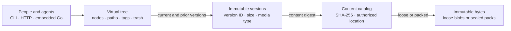

# How Docbank works

Docbank lets you and your agents organize documents without rewriting their
stored bytes. It separates where a document appears from where its bytes live,
presenting directories and files as a virtual tree backed by a database and a
separate content store.

Two parts make this work:

- **SQLite metadata.** Holds the tree you work with, including stable document
  identity, paths, versions, tags, provenance, trash state, and search indexes.
- **Immutable content storage.** Holds the document bytes, addressed by their
  SHA-256 digest and stored either as individual files or inside sealed pack
  files.

When you move a document, Docbank updates metadata instead of copying bytes.
Identical content shares storage, and each edit keeps the earlier version.
Backups can rebuild the same document collection even when the restored storage
layout differs.

You do not have to keep everything in one global archive on a machine. You or
an application can run many independent vaults, each with its own identity,
metadata, content, policy, and backup history.

## The model in one minute

Five ideas explain how the pieces fit together:

1. A **vault** is an independent document collection whose database and content
   store act as one logical unit.
2. A **node** is a directory or file with a stable numeric ID. You can change
   its path without changing which document it is.
3. A **content version** is an immutable historical record of a file, with its
   own random UUID. When you edit or revert a file, Docbank creates a new
   version and never rewrites an old one.
4. A **blob** is the byte content shared by one or more versions. Its SHA-256
   digest is its identity, so byte-identical files share storage automatically.
5. The **catalog** decides which bytes are authoritative and where Docbank can
   read them. A loose file or pack entry sitting on disk has no authority by
   itself.

To read a file by path, Docbank follows four steps in order:

1. Resolve the path to a node.
2. Read the file node's current version ID.
3. Read that version's content digest.
4. Ask the catalog which stored copy can supply those bytes.

Neither a path name nor a stray file on disk can authorize a read on its own.

## Identity, addressing, and authority

These values answer different questions, and you cannot swap one for another:

| Value | What it answers | Stability and authority |
| --- | --- | --- |
| Vault ID | Which independent collection is this? | Stable across backup and restore |
| Node ID | Which directory or file is this? | Stable across moves, renames, trash, and restore |
| Path | Where is the node shown now? | Mutable addressing convenience, derived from the tree |
| Node revision | Which observed node state am I changing? | Advances on mutation; used by `If-Match` to reject stale writes |
| Version ID | Which historical file state is this? | Random, immutable, and independent of the node's current path |
| Blob digest | Which exact bytes are these? | SHA-256 of the content; identical bytes have one identity |
| Catalog membership and mapping | May Docbank read this content, and from where? | A `blobs` row grants authority; an optional pack mapping selects packed rather than loose storage |

Because paths can change, any automation you write should store node and
version IDs rather than paths alone. Likewise, finding a correctly named file
under `blobs/` does not make that file part of the vault; only a committed
catalog reference does.

## How a write becomes authoritative

Every way of writing content follows the same rule. Docbank proves and
publishes the bytes before it commits any metadata that refers to them:

1. Docbank streams the incoming data into private staging while counting and
   hashing it. If you use a verified upload or content replacement, you must
   declare the expected size and digest. A mismatch ends the operation without
   granting node authority.
2. The content store syncs the completed bytes, closes the file, publishes it
   under its digest, and syncs the containing directory.
3. One SQLite transaction creates or updates the node, records the immutable
   content version, and grants the blob catalog authority.

The write endpoints differ in what you pass in and what confirmation you get
back:

| Write surface | Caller contract | Success evidence |
| --- | --- | --- |
| Server-side `/ingest` | Names paths readable by the daemon host; Docbank computes each identity | Aggregate added, skipped, excluded, and failure results for the traversal |
| Remote `/uploads` | Must declare destination, size, and SHA-256 before streaming one file | Status, committed node projection, and independently computed size and digest |
| Content replacement | Must declare size and SHA-256 and supply `If-Match` for the stable node | Committed node and version, computed identity, resulting revision, and ETag |

If the process fails before step 3, durable bytes can sit on disk without a
database reference. Those files are harmless orphans that normal reads cannot
see, and garbage collection can reclaim them later. This write order prevents
the opposite problem, where a committed version points to bytes that were never
durably published.

Tree changes such as move, rename, trash, restore, tag assignment, reversion,
and version pruning run inside SQLite transactions. Path-based mutation
endpoints resolve the path and apply the change in the same transaction, so a
concurrent move cannot silently redirect your operation.

## How a read is proved

When you read a file, Docbank walks the same authority chain in reverse:

1. Resolve a path or node ID to a file node.
2. Select its current version, or address a historical version directly.
3. Look up that version's digest in the catalog.
4. Stream the authorized loose blob or pack entry while verifying its recorded
   framing, size, and SHA-256 digest.

Receiving partial bytes does not prove a complete read. The typed clients
accept content only after reaching terminal EOF and validating the terminal
`Content-Digest` trailer. Embedded streaming applies the same rule, treating an
early close as incomplete verification rather than success.

## Editing, deletion, and reclamation are separate

Docbank separates logical document actions from physical storage maintenance:

| Operation | What changes | What does not happen yet |
| --- | --- | --- |
| Edit or replace | Adds an immutable version and advances the file's current pointer | Prior versions are not rewritten |
| Revert | Adds a new version that records the selected historical source | History is not rewound or erased |
| Version prune | Removes selected history under a revision check; dry-run is the default, but execution may be requested directly | Current content remains. `--all-prior` may replace a current revert with a same-byte checkpoint before deleting the prior version identity, and shared bytes may remain live |
| Trash | Detaches a subtree from the live tree while retaining its identity, bytes, and restore coordinates | No content is physically reclaimed |
| Trash empty | Permanently removes selected trashed metadata | Unreferenced loose files and dead pack entries may still occupy disk |
| GC | Removes unreferenced catalog authority and loose bytes | Dead entries inside an immutable pack do not shrink that pack |
| Repack | Copies live pack entries into new packs and retires sparse old packs | Logical document history is not changed |

Keeping these steps separate gives you time to undo a deletion. Docbank retains
every edit by default, and you or your agents decide when to prune history,
empty trash, and reclaim space from packs. For the command-level contracts, see
[Editing and versions](editing-and-versions.md) and
[Trash, garbage collection, repack, and verify](../usage/trash-and-gc.md).

Metadata extracted from original file formats sits outside this authority
chain. It is immutable evidence tied to a content digest and an exact version,
and it never replaces the original file. See
[Source metadata](source-metadata.md) for the typed field contract, supported
media formats, and current size limit.

## One logical content store can use several physical locations

Docbank publishes new content as a loose file named by its digest. Packing
later combines eligible small blobs into sealed, immutable pack files to reduce
filesystem enumeration and backup overhead. When the catalog switches a blob
from loose to packed, the blob digest, version identity, and document path stay
the same.

Every ingest first lands in the vault's fixed local filesystem primary. A vault
can also authorize verified copies in secondary filesystem or S3-compatible
stores. Local details such as paths, endpoints, buckets, credentials, and
observed availability stay outside portable document metadata. Instead, the
catalog records each store's stable identity and which locations hold an
independently verified copy of each SHA-256 object.

Because the catalog handles representation and location, readers do not need to
care whether content is loose or packed, local or remote. A reader picks a
currently usable catalog-authorized candidate and verifies the complete decoded
bytes. If a stream fails partway through, Docbank never silently continues from
another location, because the bytes from the first candidate are not yet
trusted. A later retry can select a different healthy copy.

Placement manages storage capacity rather than acting as synchronization or
backup. A backup captures every logical blob from one verified candidate and
omits the source store topology, and a default restore rebuilds a fresh local
primary. See [Multi-store storage](../usage/storage.md) for registration,
placement, fencing, repair, and restore mapping, and
[Loose and packed content](packed-storage.md) for representation limits and the
boundary between Docbank policy and Kit mechanics.

## One owner, two integration modes

Only one process owns an open vault at a time:

- **Daemon mode.** `docbank daemon run` owns SQLite and content storage. The
  CLI and other local tools or agents connect as thin authenticated HTTP clients.
  Discovery and auto-start never create a second storage owner.
- **Embedded mode.** A single Go application owns a separately rooted vault
  through the Go package. It applies the same metadata, content authority,
  verified reads, locking, and packing rules without running a sidecar daemon.

You cannot share a vault between both modes at the same time. Hierarchical
locks also stop a daemon or a restore from operating inside a vault tree that
another process already owns. See [Ownership and concurrency](locking.md),
[Daemon and process model](daemon.md), and [Embed in Go](../embedding.md) for
details.

## Backup reconstructs meaning, not a live database copy

Backup snapshots are immutable and incremental. Embedded applications can
forget selected snapshots and reclaim repository data that no surviving snapshot
uses. Each snapshot stores a complete deterministic JSONL description of the
logical vault along with every retained content and derivative blob, reusing
unchanged objects by digest across snapshots.

Before a restore publishes a vault, it verifies the repository, imports the
logical metadata, rebuilds search and content locations, and checks the result.
The restored vault does not have to match the source vault's loose or packed
layout. See [Backup and recovery](backup.md) for the full capture and restore
sequence, including failure and publication rules.

## Integrity boundary

Within its application and storage boundaries, Docbank is designed to detect
truncation, corruption, stale writes, malformed metadata, and incomplete
recovery:

- SHA-256 digests identify stored bytes.
- Revisions and ETags bind mutations to the state you observed.
- Catalog authority excludes stray files on disk.
- Full verification reads and hashes stored content.
- Restore validates logical relations before publishing a vault.

These checks do not defend against a host administrator, a compromised process,
or anyone able to rewrite both the stored data and its expected evidence. See
[Integrity and trust](integrity.md) for what Docbank proves, when it proves it,
and which threats require independent evidence.

## Where to go next

| If you want to understand… | Read… |
| --- | --- |
| How renditions, embeddings, and search indexes relate to originals | [Document processing](document-processing.md) |
| The on-disk database, blob tree, and enforced invariants | [Storage](storage.md) |
| Loose publication, packs, GC, and repacking | [Loose and packed content](packed-storage.md) |
| Stable versions, replacement, reversion, and pruning | [Editing and versions](editing-and-versions.md) |
| Process ownership and mutation coordination | [Ownership and concurrency](locking.md) and [Daemon and process model](daemon.md) |
| Incremental snapshots and safe publication on restore | [Backup and recovery](backup.md) |
| The contract shared by the CLI and agents | [HTTP API](http-api.md) |
| What integrity checks do and do not establish | [Integrity and trust](integrity.md) |
| Permanent retention, history, and verification | [Audited history](audited-history.md) |

For high-level product direction, see the [Roadmap](../roadmap.md). These
architecture pages explain implemented behavior and durable design intent, with
planned behavior marked as planned, rather than tracking implementation work or
status.
